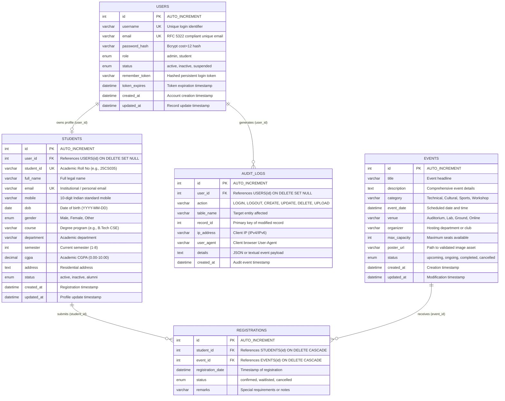

# Entity-Relationship (ER) Diagram & Database Architecture
## ITUE203 WDF — Student Hub Portal (3NF Compliant Schema)

This document specifies the complete 3NF database architecture for the **Student Hub Portal** (`student_portal` database), detailing entities, primary keys, foreign keys, constraints, cardinality relationships, and normalization justifications.

---

## 1. Relational Architecture & Normalization Analysis

### First Normal Form (1NF)
- All attributes contain only atomic (indivisible) values.
- No repeating groups or arrays stored in single columns.
- Each table possesses a unique Primary Key (`id` or natural unique keys).

### Second Normal Form (2NF)
- The schema is in 1NF.
- All non-key attributes are fully functionally dependent on the entire primary key (no partial dependencies on composite keys).

### Third Normal Form (3NF)
- The schema is in 2NF.
- There are no transitive dependencies: non-key attributes depend **only** on the primary key, directly.
- Derived values (e.g., student counts, event registration tallies) are computed dynamically via aggregation queries rather than stored statically.
- User authentication and role data is decoupled in `users`, academic profile data is isolated in `students`, event catalog in `events`, cross-entity associations in `registrations`, and security auditing in `audit_logs`.

---

## 2. Mermaid Entity-Relationship Diagram

---

## 3. Entity Dictionary & Constraints

### 3.1 `users` Table
| Column | Type | Nullable | Key / Default | Constraints / Description |
|---|---|---|---|---|
| `id` | INT UNSIGNED | NO | PK, AUTO_INCREMENT | Unique surrogate identifier |
| `username` | VARCHAR(50) | NO | UNIQUE | Alphanumeric account identifier |
| `email` | VARCHAR(100) | NO | UNIQUE | Unique validated email address |
| `password_hash` | VARCHAR(255) | NO | None | 60-char standard Bcrypt hash (`$2y$12$...`) |
| `role` | ENUM('admin','student') | NO | 'student' | Role-based authorization control |
| `status` | ENUM('active','inactive','suspended') | NO | 'active' | Account lifecycle state |
| `remember_token` | VARCHAR(255) | YES | NULL | Cryptographically secure token |
| `token_expires` | DATETIME | YES | NULL | Expiration timestamp for remember me |
| `created_at` | DATETIME | NO | CURRENT_TIMESTAMP | Record creation time |
| `updated_at` | DATETIME | NO | CURRENT_TIMESTAMP ON UPDATE | Last modification time |

### 3.2 `students` Table
| Column | Type | Nullable | Key / Default | Constraints / Description |
|---|---|---|---|---|
| `id` | INT UNSIGNED | NO | PK, AUTO_INCREMENT | Unique surrogate identifier |
| `user_id` | INT UNSIGNED | YES | FK -> `users(id)` | ON DELETE SET NULL |
| `student_id` | VARCHAR(20) | NO | UNIQUE | University Roll Number (e.g. `25CS035`) |
| `full_name` | VARCHAR(100) | NO | None | Full name of the student |
| `email` | VARCHAR(100) | NO | UNIQUE | Contact email address |
| `mobile` | VARCHAR(15) | NO | None | Mobile phone number (`^[6-9][0-9]{9}$`) |
| `dob` | DATE | YES | NULL | Birth date |
| `gender` | ENUM('Male','Female','Other') | NO | None | Gender identification |
| `course` | VARCHAR(100) | NO | None | Course / Program name |
| `department` | VARCHAR(100) | YES | NULL | Academic department |
| `semester` | TINYINT UNSIGNED | YES | 1 | Academic semester (1 through 8) |
| `cgpa` | DECIMAL(3,2) | YES | 0.00 | Cumulative Grade Point Average |
| `address` | TEXT | YES | NULL | Residential address |
| `status` | ENUM('active','inactive','alumni') | NO | 'active' | Soft-deletion flag |
| `created_at` | DATETIME | NO | CURRENT_TIMESTAMP | Registration timestamp |
| `updated_at` | DATETIME | NO | CURRENT_TIMESTAMP ON UPDATE | Profile update timestamp |

### 3.3 `events` Table
| Column | Type | Nullable | Key / Default | Constraints / Description |
|---|---|---|---|---|
| `id` | INT UNSIGNED | NO | PK, AUTO_INCREMENT | Unique surrogate identifier |
| `title` | VARCHAR(150) | NO | None | Descriptive event title |
| `description` | TEXT | NO | None | Extended markdown or plain text details |
| `category` | VARCHAR(50) | NO | 'Technical' | Classification: Technical, Cultural, etc. |
| `event_date` | DATETIME | NO | None | Scheduled start timestamp |
| `venue` | VARCHAR(100) | NO | None | Location or room number |
| `organizer` | VARCHAR(100) | NO | None | Organizing body or faculty lead |
| `max_capacity` | INT UNSIGNED | NO | 100 | Seat capacity limit |
| `poster_url` | VARCHAR(255) | YES | NULL | Validated file path in `assets/uploads/event_posters/` |
| `status` | ENUM('upcoming','ongoing','completed','cancelled') | NO | 'upcoming' | Event lifecycle state |
| `created_at` | DATETIME | NO | CURRENT_TIMESTAMP | Created timestamp |
| `updated_at` | DATETIME | NO | CURRENT_TIMESTAMP ON UPDATE | Last modification timestamp |

### 3.4 `registrations` Table
| Column | Type | Nullable | Key / Default | Constraints / Description |
|---|---|---|---|---|
| `id` | INT UNSIGNED | NO | PK, AUTO_INCREMENT | Unique surrogate identifier |
| `student_id` | INT UNSIGNED | NO | FK -> `students(id)` | ON DELETE CASCADE |
| `event_id` | INT UNSIGNED | NO | FK -> `events(id)` | ON DELETE CASCADE |
| `registration_date` | DATETIME | NO | CURRENT_TIMESTAMP | Timestamp of registration |
| `status` | ENUM('confirmed','waitlisted','cancelled') | NO | 'confirmed' | Booking state |
| `remarks` | VARCHAR(255) | YES | NULL | Optional user remarks |
| **INDEX / UNIQUE** | `(student_id, event_id)` | NO | UNIQUE KEY | Prevents duplicate event registration |

### 3.5 `audit_logs` Table
| Column | Type | Nullable | Key / Default | Constraints / Description |
|---|---|---|---|---|
| `id` | INT UNSIGNED | NO | PK, AUTO_INCREMENT | Unique surrogate identifier |
| `user_id` | INT UNSIGNED | YES | FK -> `users(id)` | ON DELETE SET NULL |
| `action` | VARCHAR(50) | NO | None | Action tag (e.g., LOGIN, LOGOUT, REGISTER, DELETE) |
| `table_name` | VARCHAR(50) | YES | NULL | Target entity |
| `record_id` | INT UNSIGNED | YES | NULL | Target entity primary key |
| `ip_address` | VARCHAR(45) | NO | None | Client IP (supports IPv4 and IPv6) |
| `user_agent` | VARCHAR(255) | YES | NULL | Client browser signature |
| `details` | TEXT | YES | NULL | JSON or human-readable description |
| `created_at` | DATETIME | NO | CURRENT_TIMESTAMP | Event log timestamp |

---

## 4. Referential Integrity Rules
1. **Cascade Deletes**: If a `student` or `event` is hard-deleted, all associated entries in `registrations` are automatically removed (`ON DELETE CASCADE`) to avoid orphaned records.
2. **Preserved History**: When a `user` is deleted, related records in `students` and `audit_logs` have their `user_id` set to `NULL` (`ON DELETE SET NULL`) to retain audit integrity and academic records.
3. **Double Registration Prevention**: Unique compound constraint `uk_student_event (student_id, event_id)` prevents race conditions or duplicate bookings for any student in any event.
