# Student Hub Portal — Site Architecture & Sitemap

```mermaid
flowchart TD
    Index["index.html<br/>(Welcome / Landing)"]
    Home["home.html<br/>(Student Portal Home)"]
    About["aboutus.html<br/>(About Mission & Team)"]
    Courses["courses.html<br/>(Academic Programs)"]
    Events["events.html<br/>(Campus Events & Registration)"]
    Notice["notice.html<br/>(Circulars & Notices)"]
    Contact["contactus.html<br/>(Contact & FAQs)"]
    JsonData["json-data.html<br/>(JSON Data Explorer)"]
    Register["Register.html<br/>(Student Registration)"]
    Login["Login.html<br/>(Authentication)"]
    Profile["profile.html<br/>(Student Profile)"]
    Attendance["Attendance.html<br/>(Attendance Tracker)"]
    Assignment["Assignment.html<br/>(Assignment Tracker)"]
    Timetable["Timetable.html<br/>(Weekly Schedule)"]
    Faculty["faculty.html<br/>(Faculty Directory)"]
    ForgotPass["forgotpassword.html<br/>(Password Recovery)"]
    ForgotUser["forgotusername.html<br/>(Username Recovery)"]
    AdminHTML["Admin.html<br/>(Admin Directory)"]

    AdminDash["php/admin/dashboard.php<br/>(Live Metrics Dashboard)"]
    AdminUsers["php/admin/users.php<br/>(Account Status Manager)"]
    AdminAudit["php/admin/audit_logs.php<br/>(Security Audit Trail)"]
    StudentCRUD["php/students/list.php<br/>(Student CRUD & Export)"]
    EventCRUD["php/events/list.php<br/>(Event CRUD & Uploads)"]
    AccessDenied["php/admin/access_denied.php<br/>(403 Forbidden)"]

    Index --> Register
    Index --> Login
    Index --> Events
    Index --> About

    Login --> Home
    Login --> Profile
    Login --> AdminDash
    Login --> ForgotPass
    Login --> ForgotUser

    Home --> About
    Home --> Courses
    Home --> Events
    Home --> Attendance
    Home --> Assignment
    Home --> Timetable
    Home --> Faculty
    Home --> Notice
    Home --> JsonData
    Home --> Profile
    Home --> Contact
    Home --> AdminHTML

    AdminDash --> StudentCRUD
    AdminDash --> EventCRUD
    AdminDash --> AdminUsers
    AdminDash --> AdminAudit
    AdminDash -. Unauthorized .-> AccessDenied
```

---

## 1. Guest & Public Navigation (Unauthenticated)

| Page | URL Path | Purpose & Accessible Features |
| :--- | :--- | :--- |
| **Welcome / Landing** | `index.html` | Portal gateway with hero introduction, direct action cards to register, login, or explore campus. |
| **About Us** | `aboutus.html` | Overview of StudentHub mission, academic leadership, core pillars, and campus stats. |
| **Courses Catalog** | `courses.html` | Directory of undergraduate and postgraduate degrees (B.Tech, BCA, MCA). |
| **Campus Events** | `events.html` | Searchable directory of workshops, hackathons, and seminars with registration modal. |
| **Notices & Circulars** | `notice.html` | Official departmental circulars, exam dates, and upcoming schedules. |
| **Contact & FAQs** | `contactus.html` | College contact details, campus location map, collapsible FAQ accordion, and inquiry form. |
| **Student Registration** | `Register.html` | Accessible registration form with HTML5 inputs, JS regex validation, password strength meter, and CAPTCHA. |
| **Student Login** | `Login.html` | Secure credential entry with role selection and remember-me token option. |
| **Password Recovery** | `forgotpassword.html` | Form for password reset verification. |
| **Username Recovery** | `forgotusername.html` | Form for student ID recovery. |

---

## 2. Authenticated Student Navigation

| Page | URL Path | Key Interactive Features |
| :--- | :--- | :--- |
| **Student Home** | `home.html` | Hero interactive carousel slider, upcoming events grid, quick links, and notification banner. |
| **Profile** | `profile.html` | Displays student ID, full name, email, department, year, CGPA, and contact details. |
| **Attendance Tracker** | `Attendance.html` | Real-time percentage tracking, lecture counts, lab sessions, and exam eligibility indicators. |
| **Assignment Tracker** | `Assignment.html` | Upcoming assignment deadlines, submission portals, and grading statuses. |
| **Timetable** | `Timetable.html` | Weekly schedule for theory classes, practical labs, and faculty office hours. |
| **Faculty Directory** | `faculty.html` | Departmental professors, office rooms, email contacts, and subject specializations. |
| **JSON Data Explorer** | `json-data.html` | Demonstration of asynchronous Fetch API with search, category filtering, sorting, and pagination. |

---

## 3. Administrative Navigation (Role: `admin`)

| Dashboard / Tool | URL Path | Administrative Functionality |
| :--- | :--- | :--- |
| **Admin Overview** | `Admin.html` | Static administrative overview with client-side dependent dropdown filtering (Country &rarr; State &rarr; City). |
| **Live Admin Dashboard** | `php/admin/dashboard.php` | Real-time aggregated statistics (students, events, registrations, users), recent tables, and charts. |
| **Student Management** | `php/students/list.php` | Paginated student table, keyword search, course filtering, soft delete, and CSV export. |
| **Add Student** | `php/students/create.php` | Form to add student record with prepared statement insert and duplicate checks. |
| **Edit Student** | `php/students/update.php` | Form to edit academic and personal details of a student record. |
| **Event Management** | `php/events/list.php` | Event list with poster previews, seat counters, and edit/delete triggers. |
| **Add Event** | `php/events/create.php` | Create event with file validation and poster upload (max 2 MB, JPG/PNG/WEBP). |
| **User Accounts** | `php/admin/users.php` | Manage system login accounts and toggle Active/Inactive statuses. |
| **Security Audit Logs** | `php/admin/audit_logs.php` | Audit trail with action filter, search, user-agent tracking, and IP address logging. |
| **Access Denied** | `php/admin/access_denied.php` | HTTP 403 Forbidden page for unauthenticated access attempts. |

---

## 4. API Endpoints (RESTful JSON)

| Endpoint | Supported Methods | Description |
| :--- | :--- | :--- |
| `php/api/students.php` | `GET`, `POST`, `PUT`, `DELETE` | Asynchronous CRUD for student records with JSON payload and pagination. |
| `php/api/events.php` | `GET`, `POST`, `PUT`, `DELETE` | Asynchronous CRUD for campus events with category and status filters. |
| `php/api/faqs.php` | `GET` | Filterable and searchable JSON endpoint for campus FAQs. |
| `php/auth/check_session.php`| `GET` | Returns session status, remaining timeout seconds, and user identity. |
